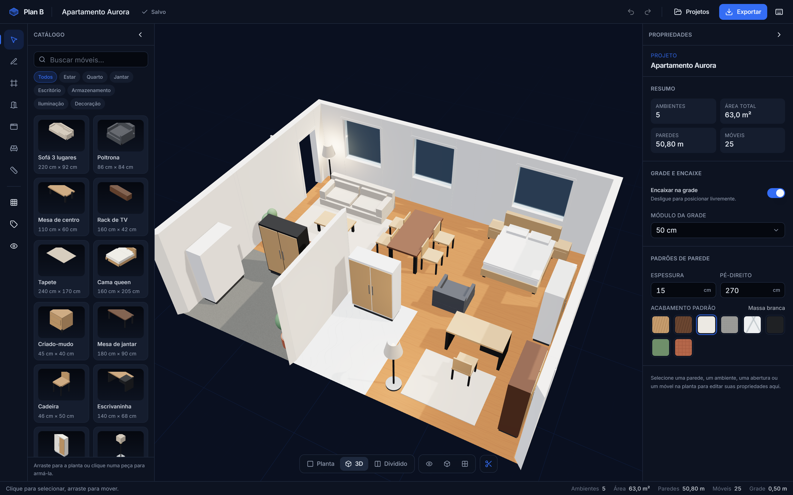
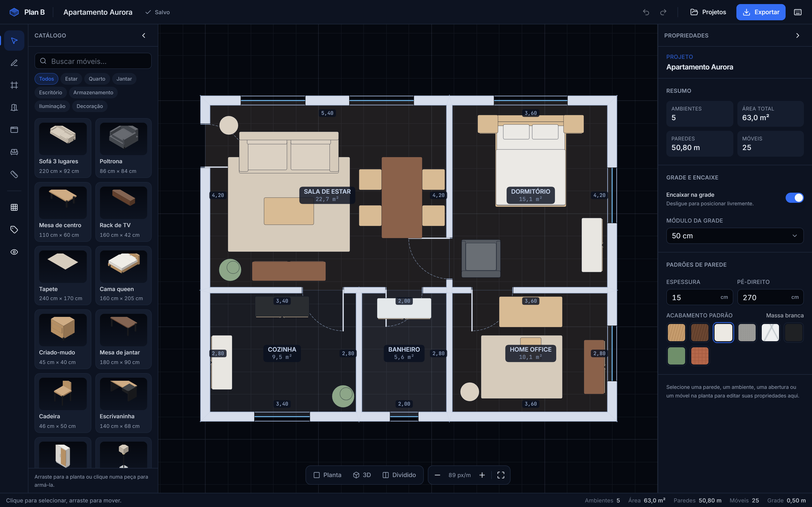
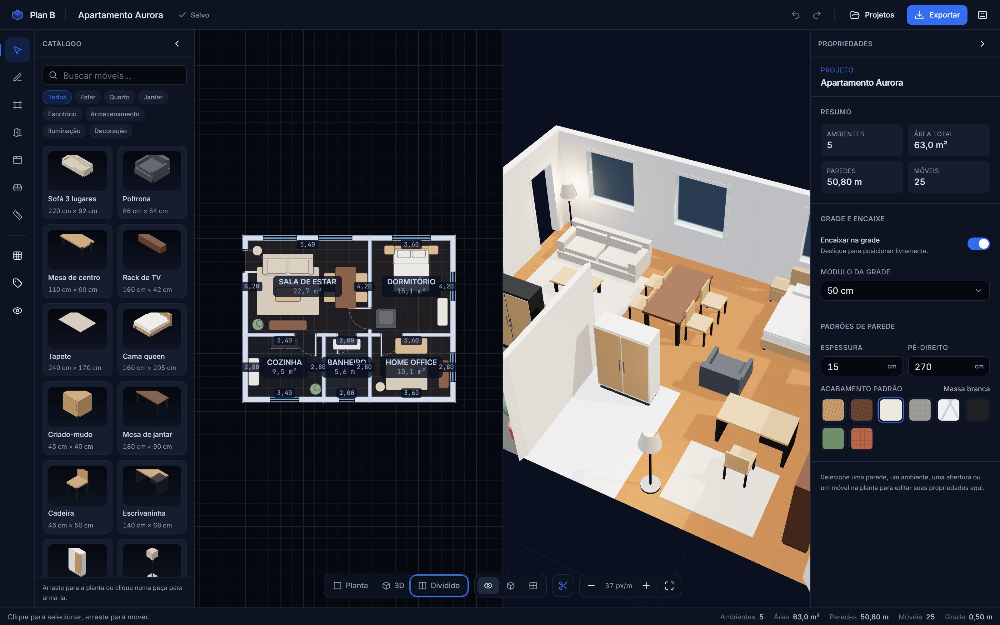

<div align="center">

# Plan B

**Estúdio de design de interiores 2D/3D no navegador.**
Desenhe a planta baixa e veja o ambiente tomar forma em 3D, em tempo real.

[Arquitetura](#arquitetura) · [Como rodar](#como-rodar) · [Comandos](#comandos-disponíveis) ·
[Modelo de dados](#modelo-de-dados) · [Decisões técnicas](#decisões-técnicas) ·
[Limitações](#limitações-atuais) · [Próximos passos](#próximos-passos)



</div>

---

Plan B é um editor espacial completo: paredes como um grafo de cantos compartilhados,
ambientes detectados automaticamente a partir dos ciclos fechados, portas e janelas que viram
vãos de verdade na cena 3D, catálogo de móveis procedurais e histórico de comandos com
desfazer/refazer. Abre direto no editor, com um apartamento mobiliado de exemplo e **sem
cadastro**.

> **Idioma.** A interface e esta documentação são em português do Brasil, acompanhando o
> público do projeto. O código, os comentários e as mensagens de commit estão em inglês.

<table>
  <tr>
    <td width="50%"></td>
    <td width="50%"></td>
  </tr>
  <tr>
    <td align="center"><sub>Planta 2D: cotas, arcos de porta, áreas por ambiente</sub></td>
    <td align="center"><sub>Vista dividida: as duas projeções do mesmo documento</sub></td>
  </tr>
</table>

---

## Destaques

|                                |                                                                                                                                       |
| ------------------------------ | ------------------------------------------------------------------------------------------------------------------------------------- |
| **Uma única fonte de verdade** | O 2D e o 3D são projeções do mesmo documento. Não existe geometria duplicada entre as vistas.                                         |
| **Vãos reais, sem CSG**        | Uma parede reta com aberturas retangulares se decompõe exatamente em caixas. Robusto, rápido e sem dependências frágeis.              |
| **Ambientes automáticos**      | Travessia de faces do grafo planar de paredes: feche um ciclo e o ambiente aparece; remova uma divisória e os vizinhos se fundem.     |
| **Histórico por patches**      | `immer.produceWithPatches` dá inversos baratos; um arrasto inteiro vira um único passo de desfazer.                                   |
| **Funciona offline**           | Sem backend no ar, o editor salva no navegador. Com o backend, migra para o servidor de forma transparente.                           |
| **Móveis procedurais**         | 13 peças descritas como primitivas normalizadas — a miniatura do catálogo, a projeção em planta e a malha 3D saem da mesma definição. |

---

## Como rodar

**Pré-requisitos:** Node 20+ e pnpm 9. Docker é opcional.

```bash
pnpm install
pnpm dev
```

Pronto: <http://localhost:5173> abre o estúdio com o apartamento de demonstração, salvando no
`localStorage`. **Nenhum banco de dados é necessário para usar o produto.**

### Com persistência no servidor (opcional)

```bash
cp .env.example .env
pnpm db:up          # sobe o PostgreSQL 16 via docker compose
pnpm db:migrate     # cria o schema
pnpm db:seed        # carrega o apartamento de demonstração
pnpm dev:api        # API em http://localhost:3333, docs em /docs
```

Com a API no ar, o front detecta o backend em uma única sondagem de `/api/health` no boot e
passa a salvar no servidor. Se o banco cair, a API responde `503` nas rotas de projeto e a
interface informa onde os dados estão sendo gravados.

Há um único arquivo de ambiente, na raiz: o `docker compose`, o `@nestjs/config`, o Vite
(via `envDir`) e o CLI do Prisma (via `dotenv-cli`) leem todos o mesmo `.env`.

---

## Arquitetura

```
plan-b/
├─ packages/shared     @plan-b/shared  domínio, geometria, catálogo, validação
├─ apps/web            @plan-b/web     editor React (canvas 2D + cena R3F)
└─ apps/api            @plan-b/api     API REST NestJS + Prisma + PostgreSQL
```

O fluxo de dependências é estritamente unidirecional: `shared` não conhece nem o front nem o
back; ambos dependem apenas dele.

```
                       ┌───────────────────────────────┐
                       │      @plan-b/shared       │
                       │  tipos · geometria · zod ·    │
                       │  catálogo · migrações         │
                       └───────┬───────────────┬───────┘
                               │               │
            ┌──────────────────▼──┐     ┌──────▼──────────────┐
            │       apps/web      │     │      apps/api       │
            │                     │     │                     │
            │  store/   commands  │     │  projects module    │
            │  canvas2d/ renderer │     │  prisma service     │
            │  viewer3d/ R3F      │     │  zod pipes          │
            │  features/ UI       │     │  swagger            │
            │  services/ persist  │     │                     │
            │  export/   PNG+JSON │     │                     │
            └─────────────────────┘     └─────────────────────┘
```

### O documento é a única geometria

```
FloorPlan (metros, canônico)
   │
   ├── buildScene()    memoizado por nível  →  renderer 2D (Canvas 2D imperativo)
   └── buildScene3D()  memoizado por nível  →  cena R3F (paredes, pisos, móveis)
```

Nenhuma camada de renderização escreve no documento. Toda mutação passa por um **comando**
despachado na store, o que é exatamente o que mantém o desfazer correto e o que impede as duas
vistas de divergirem.

### Camadas do front

| Pasta       | Responsabilidade                                                                    |
| ----------- | ----------------------------------------------------------------------------------- |
| `store/`    | Documento + histórico (`project-store`) e estado efêmero de edição (`editor-store`) |
| `editor/`   | Comandos (mutações nomeadas) e histórico por patches                                |
| `canvas2d/` | Viewport, cena derivada, renderer imperativo, hit-testing e interações de ponteiro  |
| `viewer3d/` | Geometria 3D derivada, materiais, iluminação, câmera e captura                      |
| `features/` | Componentes de UI (shell, inspector, catálogo, exportação)                          |
| `services/` | Repositórios de persistência, sondagem de backend, autosave                         |
| `export/`   | PNG da planta, captura 3D, arquivo de projeto                                       |

### Sistema de coordenadas

- Unidade: **metros**, inclusive no formato persistido.
- Planta: `x` para leste, `y` para o sul (para baixo na tela, convenção de canvas).
- 3D: planta `(x, y)` vira `(x, 0, y)`; `+Y` é a altura. Uma rotação `r` na planta é `-r` em
  torno de Y no three.js. A conversão vive num único lugar (`planRotationToThree`).

---

## Modelo de dados

| Entidade        | Campos principais                                                       |
| --------------- | ----------------------------------------------------------------------- |
| `WallNode`      | `id, x, y` — canto compartilhado entre paredes                          |
| `Wall`          | `id, a, b, thickness, height, materialId`                               |
| `Opening`       | `id, wallId, kind, offset, width, height, sill, flipped, swingReversed` |
| `Room`          | `id, name, nodeIds[], floorMaterialId, autoNamed`                       |
| `FurnitureItem` | `id, catalogId, position, rotation, size, materialId, elevation`        |
| `Level`         | `id, name, elevation, nodes/walls/openings/rooms/furniture`             |
| `FloorPlan`     | `schemaVersion, levels[], settings`                                     |
| `Project`       | `id, name, plan, createdAt, updatedAt, workspaceId?`                    |

**Paredes são um grafo, não uma lista de segmentos.** Cada parede referencia dois `WallNode`
por id. É isso que permite arrastar um canto e mover todas as paredes conectadas, detectar
ambientes por ciclos e dividir uma parede quando outra encosta nela.

**Ambientes não são desenhados, são derivados.** `detectRoomLoops` percorre cada meia-aresta do
grafo escolhendo sempre o vizinho imediatamente no sentido horário; cada ciclo fechado é uma
face, e a face de maior área em cada componente conexo é descartada por ser a borda externa.
Ao re-sincronizar, um ambiente é reconhecido primeiro pelo conjunto de cantos e, se isso
mudou, pelo centróide contido no novo polígono — assim o nome que você deu sobrevive a uma
parede arrastada ou dividida.

**Encontros de parede são mitrados**, não sobrepostos. Em volta de cada canto as paredes são
tomadas em ordem angular e cada par vizinho define um ponto: o cruzamento da face esquerda de
uma com a face direita da seguinte. Esses pontos cortam as pontas das paredes e, quando três ou
mais se encontram, o polígono que eles descrevem vira uma peça de preenchimento. As peças
ladrilham a junção exatamente — sem vão, sem sobreposição e sem nada coplanar, que é o que
antes fazia o 3D listrar no topo das paredes.

**Aberturas são posições paramétricas**, não recortes. `offset` é a distância do canto `a` até
o centro do vão, ao longo da linha de eixo. Mover a parede leva as aberturas junto; encurtá-la
reposiciona (ou estreita) o que não cabe mais.

Uma porta tem dois eixos independentes: `flipped` escolhe a ponta onde fica a dobradiça (a
"mão") e `swingReversed` escolhe para qual face da parede ela abre. Juntos dão as quatro
combinações que uma porta real tem, e o símbolo em planta e a folha no 3D leem os mesmos dois
booleanos.

### Versionamento e migração

`FloorPlan.schemaVersion` acompanha o formato gravado. Toda leitura — arquivo importado, entrada
do `localStorage` ou linha do banco — passa por `migratePlan()` antes da validação. A cadeia de
migrações está em `packages/shared/src/schema/migrations.ts`. A versão corrente é `2`: a `1` não
conhecia o lado de abertura da porta, e a migração o adiciona. Nenhum ponto de chamada precisou
mudar — os schemas zod que guardam a API, o arquivo importado e o `localStorage` já migram o
que recebem. Um arquivo
gravado por uma versão mais nova é recusado com uma mensagem clara em vez de ser lido pela
metade.

---

## Comandos disponíveis

Na raiz do monorepo:

| Comando           | O que faz                                   |
| ----------------- | ------------------------------------------- |
| `pnpm dev`        | Editor em modo desenvolvimento (porta 5173) |
| `pnpm dev:api`    | API em modo watch (porta 3333)              |
| `pnpm dev:all`    | Front e API em paralelo                     |
| `pnpm build`      | Compila `shared`, `web` e `api`             |
| `pnpm test`       | Testes unitários dos três pacotes           |
| `pnpm test:e2e`   | Suíte Playwright sobre o build de produção  |
| `pnpm typecheck`  | `tsc --noEmit` em todos os pacotes          |
| `pnpm lint`       | ESLint 9 (flat config) no monorepo          |
| `pnpm format`     | Prettier em todo o repositório              |
| `pnpm db:up`      | Sobe o PostgreSQL via docker compose        |
| `pnpm db:down`    | Derruba os containers                       |
| `pnpm db:migrate` | Aplica as migrações do Prisma               |
| `pnpm db:seed`    | Insere o projeto de demonstração            |

### API REST

Documentação OpenAPI interativa em <http://localhost:3333/docs>.

| Método   | Rota                          | Descrição                                     |
| -------- | ----------------------------- | --------------------------------------------- |
| `GET`    | `/api/health`                 | Liveness + prontidão do banco                 |
| `GET`    | `/api/projects`               | Lista os projetos do workspace                |
| `GET`    | `/api/projects/:id`           | Lê um projeto, já migrado para o schema atual |
| `POST`   | `/api/projects`               | Cria um projeto                               |
| `PATCH`  | `/api/projects/:id`           | Atualiza nome, planta ou ambos                |
| `POST`   | `/api/projects/:id/duplicate` | Duplica dentro do mesmo workspace             |
| `DELETE` | `/api/projects/:id`           | Exclui permanentemente                        |

Todas as rotas de projeto exigem o cabeçalho `x-workspace-id`.

---

## Atalhos de teclado

| Ferramentas    |     | Edição                 |     | Visualização                       |
| -------------- | --- | ---------------------- | --- | ---------------------------------- |
| `V` selecionar |     | `Ctrl+Z` desfazer      |     | `1` `2` `3` planta/3D/dividido     |
| `P` parede     |     | `Ctrl+Shift+Z` refazer |     | `G` grade                          |
| `A` ambiente   |     | `Ctrl+S` salvar agora  |     | `C` cotas                          |
| `D` porta      |     | `Ctrl+D` duplicar      |     | `H` móveis                         |
| `J` janela     |     | `Delete` excluir       |     | `Shift+F` enquadrar                |
| `M` móveis     |     | `[` `]` girar 15°      |     | `Espaço` + arrastar: mover a vista |
| `T` medir      |     | setas: mover 5 cm      |     | scroll: aproximar/afastar          |

`?` abre a lista completa dentro do app.

---

## Decisões técnicas

### 2D em Canvas imperativo, não SVG nem React

A planta redesenha a cada movimento de ponteiro. Reconciliar centenas de nós React a 60 fps é
desperdício; um único `<canvas>` com laço de render e flag de sujeira mantém a latência do
ponteiro constante — e torna a exportação em PNG de alta resolução uma troca de viewport.

### Vãos por decomposição, não por CSG

Operações booleanas em geometria extrudada são lentas e frágeis. Uma parede reta com aberturas
retangulares se fatora **exatamente** em caixas: trechos cheios entre vãos, peitoril e verga.
`wallSolidSegments()` devolve essa decomposição, coberta por testes que conferem a conservação
de área. Resultado: vãos reais, zero dependências extras.

### Mitra em vez de sobreposição

A primeira versão fazia cada parede crescer além do seu nó, deixando que a sobreposição
cobrisse o canto. Isso resolve o preenchimento em 2D, mas em 3D dois corpos sobrepostos
compartilham faces coplanares e o _z-buffer_ não tem como ordená-las — é o listrado que
aparecia no topo das paredes. Mitrar remove a sobreposição em vez de escondê-la, e de quebra
deixa a planta geometricamente correta: as peças ladrilham, não se empilham.

O mesmo cuidado vale para as mós de porta e janela: elas entram alguns milímetros parede
adentro, de modo que a face que encosta fica enterrada dentro do sólido, onde não pode ser
vista nem disputada.

### Corte automático das paredes no 3D

Uma parede é escondida quando a câmera e o centro da planta ficam em lados opostos dela — o que
é exatamente o conjunto de paredes entre o observador e o interior. Isso dá a vista "casa de
bonecas" por padrão, sem caso especial para a vista superior (de cima, a câmera fica do mesmo
lado de todas as paredes).

### Histórico com patches do immer

Um comando é uma função pura sobre um rascunho. `produceWithPatches` devolve os patches diretos
e os inversos, então desfazer custa o tamanho da mudança, não o tamanho do documento. Comandos
consecutivos com a mesma `coalesceKey` dentro de uma janela curta se fundem: arrastar um móvel
gera **um** passo de desfazer, não sessenta.

### Zod no `shared`, validando três fronteiras

O mesmo schema valida o corpo da requisição na API, o arquivo JSON importado e o payload lido do
`localStorage`. Uma planta que o editor aceita é aceita pelo servidor, e uma que ele recusaria
nunca chega ao banco.

### Repositórios como abstração de persistência

`LocalProjectRepository` e `HttpProjectRepository` implementam a mesma interface. Uma sondagem
de `/api/health` no boot escolhe qual delas a sessão usa, e a escolha é fixa durante a sessão —
alternar de backend no meio do trabalho seria mais confuso do que informar claramente onde os
dados estão.

### Móveis procedurais em vez de GLTF

Cada peça é uma lista de primitivas em espaço normalizado. A mesma lista gera a miniatura
isométrica em SVG do catálogo, a projeção em planta e a malha 3D. Sem download de assets, sem
licenciamento, sem LFS — e trocar o material repinta tudo instantaneamente.

### Plantas em JSONB, não normalizadas

A planta é lida e escrita inteira, sempre. Espalhar paredes, ambientes e móveis em tabelas
custaria um `JOIN` pesado em cada abertura de projeto sem benefício nenhum. `schemaVersion` é
espelhado em coluna para que uma migração futura consiga encontrar as linhas antigas sem varrer
o JSON.

---

## Testes

```bash
pnpm test        # 272 testes unitários (114 shared · 126 web · 32 api)
pnpm test:e2e    # 16 fluxos ponta a ponta
```

| Pacote   | Cobertura                                                                                                                                                                                           |
| -------- | --------------------------------------------------------------------------------------------------------------------------------------------------------------------------------------------------- |
| `shared` | geometria (áreas, centróides, offsets), detecção de ambientes, decomposição de paredes, encaixe de aberturas, snapping, validação e round-trip de serialização                                      |
| `web`    | histórico (inversos, coalescência, limites), comandos (divisão de parede, fusão de ambientes, limites de móveis), transformações de viewport, prioridade de hit-testing, store e arquivo de projeto |
| `api`    | serviço de projetos (escopo de workspace, 404, 503, linha corrompida, duplicação) e pipe de validação zod                                                                                           |

A suíte E2E dirige o canvas de verdade, com eventos de ponteiro reais, convertendo coordenadas
em metros para pixels a partir do zoom exibido na interface — ela quebra se o hit-testing, o
snapping ou o laço de render regredirem. Ela roda sobre o build de produção e aborta a sondagem
de `/api/health` na camada de rede, de modo que exercita o caminho sem backend — o estado padrão
da demo — independentemente do que esteja rodando na máquina.

A CI tem ainda um job com um PostgreSQL de verdade que aplica as migrações versionadas e falha
se `schema.prisma` divergir delas.

As imagens deste README são geradas pela própria suíte:

```bash
CAPTURE_SCREENSHOTS=1 pnpm --filter @plan-b/web test:e2e screenshots
```

---

## Limitações atuais

- **Um pavimento.** O modelo já é multi-nível (`levels[]`), mas a interface expõe apenas o
  primeiro.
- **Paredes retas.** Sem curvas, sem paredes inclinadas, sem escadas.
- **Desktop.** O editor é desenhado para ponteiro e teclado; abaixo de `lg` o layout fica
  apertado. Não há modo touch dedicado.
- **Somente tema escuro.** O renderer 2D pinta com a própria paleta, não com CSS, então um tema
  claro exigiria desenhar a planta de novo — e não meia dúzia de variáveis trocadas.
- **Sem autenticação, por decisão de escopo.** Projetos no servidor são escopados por um id de
  workspace anônimo guardado no navegador. Quem tiver o id lê e escreve — os dados do servidor
  são explicitamente descartáveis.
- **Sem colaboração.** Duas abas abertas no mesmo projeto sobrescrevem uma à outra; não há
  detecção de conflito.
- **Materiais são presets.** Não há upload de textura nem editor de material.
- **Sem exportação em PDF ou link público.** Tratados como melhorias futuras no escopo original.
- **Sem persistência de histórico.** Desfazer/refazer vive na sessão; recarregar a página zera a
  pilha (o documento, esse sim, é recuperado).
- **Cliente novo contra servidor antigo é recusado.** A API valida contra a sua própria cópia do
  schema, então um plano de versão mais nova volta `400` em vez de ser gravado pela metade. É o
  comportamento seguro, mas significa que front e back sobem juntos.

---

## Próximos passos

1. **Múltiplos pavimentos** com navegação entre níveis e laje/forro entre eles.
2. **PDF cotado** reaproveitando o renderer de exportação, com escala e carimbo.
3. **Links públicos de compartilhamento**, somente leitura, com visualização 3D embutida.
4. **Cotas encadeadas e cadeias de medida**, no estilo CAD.
5. **Detecção de conflito no autosave** (versão otimista no `PATCH`).
6. **Catálogo extensível** com upload de GLTF e materiais customizados.
7. **Modo apresentação** com passeio em primeira pessoa.
8. **Acessibilidade de edição**: mover e girar objetos inteiramente pelo teclado já funciona;
   falta navegar entre objetos com `Tab` dentro do canvas.

---

## Licença

MIT.
